# HandNavigate collection worker and StickerDock integration

28 October 2026. This adds an always-on worker mode to HandNavigate, using the same download/verification `Runner` as the desktop app. The portable desktop EXE remains a separate entry point; its loopback saved-workflow API is not this parameterized collection API.

## The intended daily flow

```mermaid
flowchart LR
  A[StickerDock existing Groq planner] --> B[Saved daily topic brief]
  B --> C[StickerDock Python caller / daily trigger]
  C -->|topics + source IDs + total limit| D[HandNavigate worker API]
  D --> E[Own persistent source browsers]
  E --> F[Decode / deduplicate / save locally]
  F --> G[StickerDock authenticated intake]
  G --> H[Supabase private objects + metadata rows]
  H --> I[Rights / quality admission]
  I --> J[Existing caption / render / private draft workflow]
```



StickerDock decides what topics it needs. HandNavigate performs website search, pagination, downloading, decoding, duplicate checks and delivery. No chat, Codex browser or model call is required for repeat execution. News briefs supply topic text only; news/blog images, Commons and Openverse are not fallback image sources in this worker.

One request's `limit` is shared by all topics and sources. A 20-image request does not become 20 images per topic/platform. If a source fails, another configured source can fill the remaining count. The default global daily budget is 20 saved images in Asia/Kolkata; set `HANDNAVIGATE_DAILY_LIMIT` deliberately to grow it. Source readiness is reported separately, so an overall successful collection can still show an unavailable platform.

## What was actually verified

- The real worker HTTP API and its own Chrome profiles saved and independently decoded **20 Pinterest images** for `funny cat reaction`. A separate Reddit qualification saved **4 images** across `cute cat` and `cute dog`. All 24 have distinct byte hashes. [Live metadata evidence](service/evidence/live-20261028.json). Downloaded images and account profiles are local under `runtime/service-live/`, excluded from Git.
- The first live attempts exposed navigation timing and different Reddit media-search markup. Those were fixed. Human verification was required in the worker's separate browser; a successful session today does not prove unattended access tomorrow or from a server IP.
- The cross-repo check ran **StickerDock's Python caller → HandNavigate's public API/real browser runner → StickerDock's production intake handler**. It decoded, stored, fetched and verified 20 images and 20 database records using an owned HTTP source and a disposable SQLite/blob fixture. [Cross-repo evidence](service/evidence/cross-repo.json). This is **not a production Supabase write**.
- Local checks: 36 core tests, all 38 desktop checks and 5 worker tests passed; StickerDock's 274 backend tests and local SQL migration/grant checks also passed. They cover shared counts, library deduplication, durable request IDs, restart, daily budget, partial delivery resume, tampered files, authentication, metadata/read-back and lock exclusion. See [core](analysis/service-core-console.txt), [desktop](analysis/service-desktop-console.txt) and [worker](analysis/service-api-console.txt) logs. New hosted CI and Linux/Docker execution still need qualification.

No downloaded social image has been published or sent to an AI model by these checks. The current Windows portable executable was not rebuilt to embed the worker.

## Where to deploy

Keep **Vercel** for the existing StickerDock Admin and short intake calls. Keep **Supabase PostgreSQL + Storage** for metadata and binary media. Run **HandNavigate on one persistent Windows/Linux host** with disk-backed browser profiles; do not try to hold a logged-in Chromium session inside a Vercel request.

Start on the current Windows machine for qualification. For an always-on installation, a reasonable initial sizing estimate is a Linux VM with 2 vCPU, 4 GB RAM and 20–40 GB persistent disk, running one job at a time. This is a sizing estimate, not a measured server capacity or hosting-price quote. A desktop/remote-console session must be available when a source requires manual login or human verification. Never solve challenges automatically.

`service/Dockerfile` and `service/compose.yaml` prepare container operation and a persistent `/data` volume. The host mapping binds to loopback. Place a TLS reverse proxy or private network in front of it before a remote StickerDock caller connects. Never expose a browser debugger or profile folder. Server-IP login, image access, Docker startup and restart recovery must pass on the selected host before enabling its schedule. Container deployment has not been run here.

Vercel has bounded function lifetimes/payloads: [official limits](https://vercel.com/docs/functions/limitations). GitHub's scheduled workflow can be delayed, so the schedule is approximate: [official schedule behavior](https://docs.github.com/en/actions/reference/workflows-and-actions/events-that-trigger-workflows#schedule).

## Local startup and one-time login

From the HandNavigate repository:

```powershell
npm ci
# Use Chrome already installed on Windows, or install Playwright Chromium:
$env:HANDNAVIGATE_BROWSER_CHANNEL = 'chrome'
# Stop the worker before its separate login helper uses the same profiles.
npm run service:login -- pinterest
npm run service:login -- reddit
npm run service
```

The default worker address is `http://127.0.0.1:47832`. Local-only collection works without StickerDock secrets. A local 256-bit API token is created in ignored `runtime/service/service-key.json`. Provision that token into StickerDock's server-side `HANDNAVIGATE_API_TOKEN`; keep it out of browser code, Git and logs. Persistent logins belong to this worker, not Codex or the desktop app's Electron profile.

For a production storage destination, configure:

| Location | Setting | Purpose |
| --- | --- | --- |
| HandNavigate | `STICKERDOCK_BASE_URL` | Existing StickerDock HTTPS origin |
| HandNavigate | `STICKERDOCK_INGEST_TOKEN` | Token for `/api/ingest` |
| HandNavigate | `HANDNAVIGATE_API_TOKEN` | Optional explicit caller token; otherwise use its persisted key |
| HandNavigate | `HANDNAVIGATE_DAILY_LIMIT` | Total daily saved-image ceiling; default 20 |
| HandNavigate | `HANDNAVIGATE_DATA` | Persistent journal, download and browser-profile directory |
| StickerDock Vercel | `HANDNAVIGATE_INGEST_TOKEN` | Same secret as the worker's ingest token |
| StickerDock caller | `HANDNAVIGATE_URL` | Worker HTTPS URL, or loopback tunnel locally |
| StickerDock caller | `HANDNAVIGATE_API_TOKEN` | The worker's API token |

The new StickerDock migration `supabase/migrations/202610280001_media_intake.sql` and API files must be deployed first. They create a service-role-only `media_intake_items` table. Binary pixels live in private Storage at `handnavigate/candidates/<hash>.webp`; the database holds source URL, download URL, topic, platform, collection, original/stored checksums and review status. Image blobs do not belong in a PostgreSQL text column.

## API contract

Every request needs `Authorization: Bearer ...`. Web-page Origins are rejected. Parameters name only server-configured sources; a caller cannot submit arbitrary website URLs, selectors, scripts, output folders or credentials.

```http
POST /v1/collections
Content-Type: application/json

{
  "requestId": "stickerdock-2026-10-28-cats-dogs-v1",
  "topics": ["funny cat reaction", "cute dog reaction"],
  "sources": ["pinterest", "reddit"],
  "limit": 20,
  "destination": "stickerdock"
}
```

| Endpoint | Meaning |
| --- | --- |
| `GET /v1/health` | Busy state, daily usage and configured storage |
| `GET /v1/sources` | Configured platform IDs |
| `POST /v1/collections` | Queue a parameterized collection; returns 202 and an ID |
| `GET /v1/collections/{id}` | Poll actual progress, source failures, files and verified storage receipts |
| `POST /v1/collections/{id}/resume` with `{}` | Reconcile saved files and retry an incomplete collection |
| `POST /v1/collections/{id}/stop` with `{}` | Stop the active collection |

Repeating the same request ID with identical parameters returns the original collection, including after restart. Conflicting parameters are rejected. Local completion is `VERIFIED_LOCAL`; confirmed remote rows and decoded image read-backs are `VERIFIED_STORAGE`. `PARTIAL`, `AUTH_REQUIRED`, `DELIVERY_FAILED`, `FAILED`, `CANCELLED` and `INTERRUPTED` are incomplete outcomes. A 202 response alone is not success. A partial run retains its files; resume does not discard them or start another full 20-image download. The caller must poll and alert on incomplete states.

To add a platform, set `HANDNAVIGATE_SOURCES_FILE` to a trusted server-side JSON array. Each recipe has `id`, `name`, `searchUrl` containing `{{topic}}`, an image `selector`, exact `allowedOrigins`/`imageOrigins`, and bounded `pagination`. `service/sources.cjs` contains the two implemented examples. URL topic values are encoded. Changed markup, media APIs, login or iframe widgets can require an adapter and live qualification; adding a name alone does not make every site work.

## StickerDock caller and daily trigger

Implemented in the sibling StickerDock repository:

```powershell
python -m tools.handnavigate_client --topic "funny cat reaction" --topic "cute dog reaction" --limit 20
python -m tools.handnavigate_client --latest-brief --limit 20 --wait
python -m tools.handnavigate_client --status COLLECTION_UUID
```

The latest-brief mode reads the existing `content_briefs` row and its `topic_plans`. It does not call Groq again. Its daily request ID binds the date, topics, sources and limit. An AI planner can call the same client after saving its brief, but need not operate a browser itself.

StickerDock has a prepared `handnavigate-intake.yml` daily/manual workflow. It stays **disabled** unless `HANDNAVIGATE_INTAKE_ENABLED=true`. Configure `HANDNAVIGATE_URL`, source IDs, the limit and server-only secrets only after the chosen host and intake endpoint pass. No new Codex automation has been created.

## Activation gaps, in order

1. Select the persistent host; install/run the worker there and sign into its own profiles. Qualify Pinterest and Reddit from that exact host, including an expired-session recovery.
2. Apply the additive Supabase migration, configure matching intake secrets and deploy StickerDock's new `/api/ingest`. Run one small real Storage/DB round trip and verify provenance and duplicate retry. Current live production data is unchanged.
3. Add the Admin intake-review surface and explicit rights/quality admission into the existing Factory `inbox/`. This patch stores candidates outside that inbox; it does not grant redistribution rights or remove StickerDock's existing Pinterest/API restrictions. For automatic admission, use reviewed source permissions and licenses, not public visibility.
4. Enable the daily workflow after configuration. Its `--wait` polling exits nonzero unless remote storage verification completes; use workflow-failure notifications and add an Admin health card for completion/missing-source counts. Observe at least seven days of source counts, duplicates, challenge frequency, storage verification, caption fit and failures before treating 20/day as a dependable production target.
5. Add bounded retention and deletion/revocation handling. Scale the budget, add source recipes/adapters and run per-platform acceptance before increasing volume. Search results are candidate media; quality, original-vs-preview selection and topical relevance are not guaranteed by a SHA-256 check.

Pinterest and Reddit have access/reuse restrictions that a downloader does not waive: [Pinterest developer guidelines](https://policy.pinterest.com/en/developer-guidelines), [Reddit Data API terms](https://redditinc.com/policies/data-api-terms). Existing Pinterest OAuth remains read-only. The live browser qualification is a technical download test, not platform authorization for a distributable daily catalog.

## Reproduce local checks

```powershell
npm test
npm run test:service
node service/cross-check.cjs "D:\5. GitUploaded\sticker"
node service/live-check.cjs
```

The cross-check uses disposable local storage and never calls an AI provider or Supabase. The live check is explicitly live, uses its own `runtime/service-live` profiles and defaults to local files. Its human-check prompt requires the person; it cannot promise unattended access.
